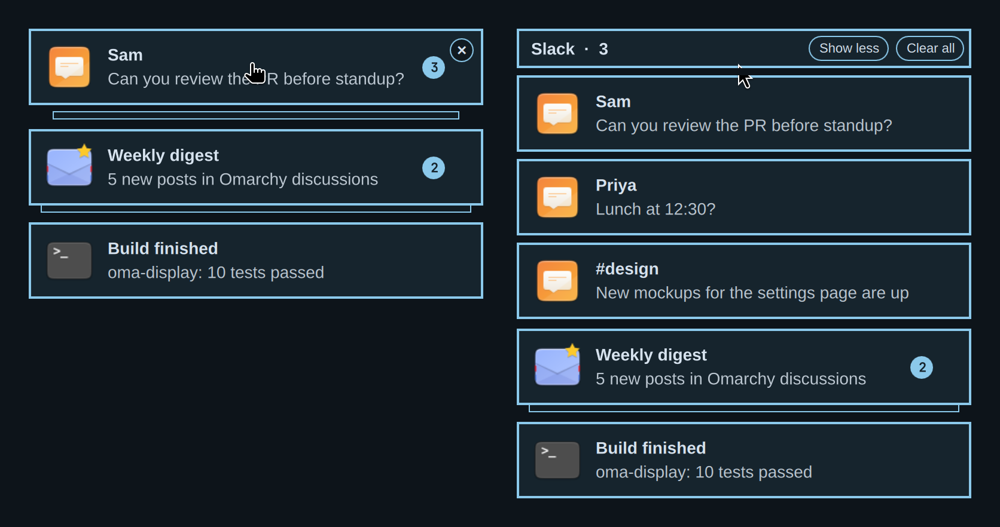

# oma-notifications

Mac-style notification popups for Omarchy. Popups from the same app collapse
into one stack instead of piling up down the screen.

<p align="center">
  
</p>

> **On Omarchy 4.5 or later?** 4.5 adds its own grouped stacks, so use the
> built-in instead. This plugin is based on the 4.0.x notifications service
> and would replace the newer one.

## What it changes

- **One stack per app.** The newest card sits on top with a count badge and
  up to two cards peeking out underneath.
- **× on hover.** On a single card it closes that card; on a stack it clears
  the whole stack. Right-click still closes too.
- **Click a stack to expand it.** You get the full list with *Show less* and
  *Clear all*, and each card has its own ×. Long lists scroll. The stack
  folds back up 5 seconds after the pointer leaves.
- **At most 3 stacks on screen.** Older stacks leave the screen the same way
  an expired popup does: into history and any notification center you use.
  A stack you are hovering over or have expanded is never pushed off.
- **Critical alerts from ordinary apps close after 30 seconds.** Some apps
  mark everyday messages critical, which made them stay forever. Omarchy's own
  critical alerts (`omarchy-action`, plain `notify-send`) still wait for you.
- **Hovering pauses the countdown on every screen,** not only the one under
  the pointer.

Everything else works like the built-in: Do Not Disturb, history,
click-to-open, and the same files under `~/.local/state/omarchy/notifications/`,
so notification-center plugins keep working.

## Install

```sh
omarchy plugin add https://github.com/avb7/oma-notifications.git --enable
omarchy restart shell
```

Enabling it switches off the built-in `omarchy.notifications`. The restart is
needed because the notifications service stays loaded across plugin reloads,
so the built-in keeps receiving notifications until the shell restarts.

Try it with some demo popups:

```sh
~/.config/omarchy/plugins/avb7.oma-notifications/tests/demo.sh
```

## Keys

Omarchy's existing bindings keep working: `SUPER + ,` dismisses the newest
popup and `SUPER + SHIFT + ,` dismisses all. One new command expands or folds
the newest stack, if you want to bind it:

```sh
omarchy-shell notifications toggleExpand
```

## Requirements

Omarchy Quattro 4.0.x. No extra packages.

## Remove

```sh
omarchy plugin remove avb7.oma-notifications
omarchy restart shell
```

Removing it switches the built-in notifications back on.

## Tests

```sh
node tests/stacks.test.js
```

## Credits

Based on the notifications service built into
[Omarchy](https://github.com/omacom/omarchy) (MIT, © David Heinemeier
Hansson). The first commit in this repository is that service unmodified, so
`git diff` against it shows exactly what this plugin changes.
